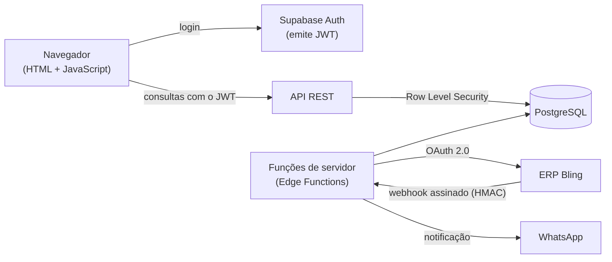

# Catálogo B2B — ProAventura

Portal de cotação para os revendedores da **ProAventura** (câmeras de ação, drones e acessórios).

> Este repositório é uma apresentação pública para portfólio. O código de produção, os dados e as
> configurações internas ficam em repositório privado.

## Problema

A equipe comercial precisava montar e enviar um PDF para cada revendedor que queria cotar produtos.
Era lento, o preço e o estoque ficavam desatualizados e não havia histórico das cotações.

## Solução

Um catálogo web onde o revendedor aprovado consulta produtos, vê o preço de revenda atualizado,
monta a cotação e recebe um comprovante em PDF da solicitação. A equipe tem um painel interno para
aprovar revendedores, acompanhar as cotações e preparar a proposta comercial.

## Arquitetura

- **Login:** feito pelo Supabase Auth, que emite um **JWT**. O HTML só mostra a tela de login.
- **Quem vê o quê:** decidido **dentro do PostgreSQL**, com Row Level Security. O preço de revenda
  só sai do banco para revendedor **aprovado**; para os demais, o banco devolve vazio, então não dá
  para vê-lo nem pelo inspetor do navegador.
- **Cargos da equipe:** conferidos no servidor a partir do perfil no banco, nunca de dados que o
  usuário consiga alterar.
- **Integrações no servidor:** o estoque vem do **ERP Bling** (OAuth 2.0 e webhook com assinatura
  HMAC verificada em tempo constante) e o aviso de cotação por **WhatsApp** foi validado em piloto.
  Tokens e chaves nunca ficam no navegador.
- **Navegador:** política de segurança de conteúdo (CSP) restrita, só com scripts autorizados.

## Qualidade

- Testes automatizados (incluindo replays de webhook e SQL com permissões simuladas) rodando no
  GitHub Actions a cada pull request.
- Fluxo com branch, pull request e revisão antes de publicar.

## Como foi desenvolvido

Em co-participação com agentes de IA: o Claude Code implementa, o Codex revisa o código e eu defino
requisitos e critérios de aceite, reviso cada alteração e valido com a equipe antes de publicar.

## Tecnologias

JavaScript · PostgreSQL (Supabase) · Row Level Security · Edge Functions · APIs REST · Webhooks ·
OAuth 2.0 · Netlify · GitHub Actions

## Status

Em desenvolvimento, com uso piloto pela equipe e revendedores.

---

**Danilo Portilho** — estudante de Engenharia da Computação · [perfil](https://github.com/daniloptoledo)
